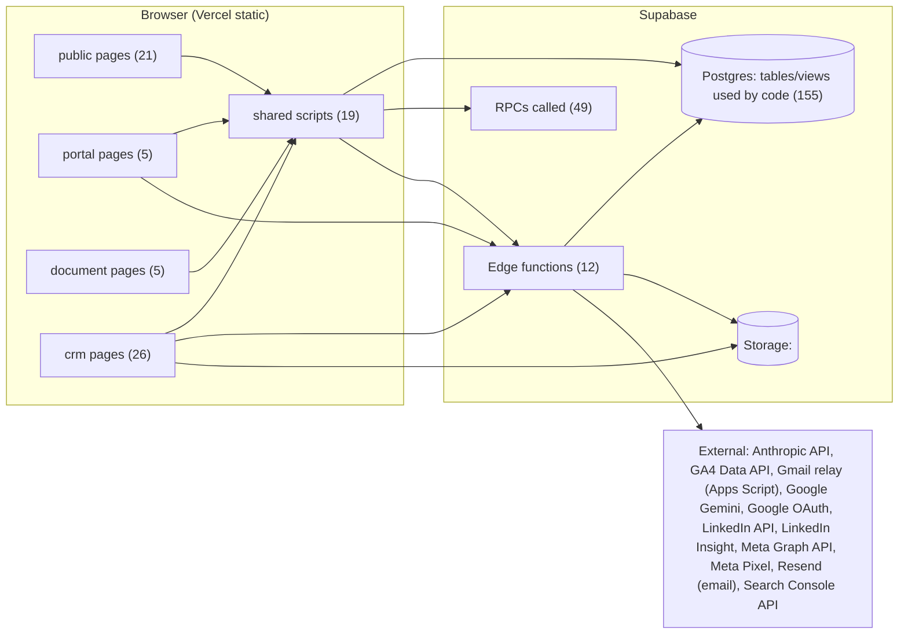
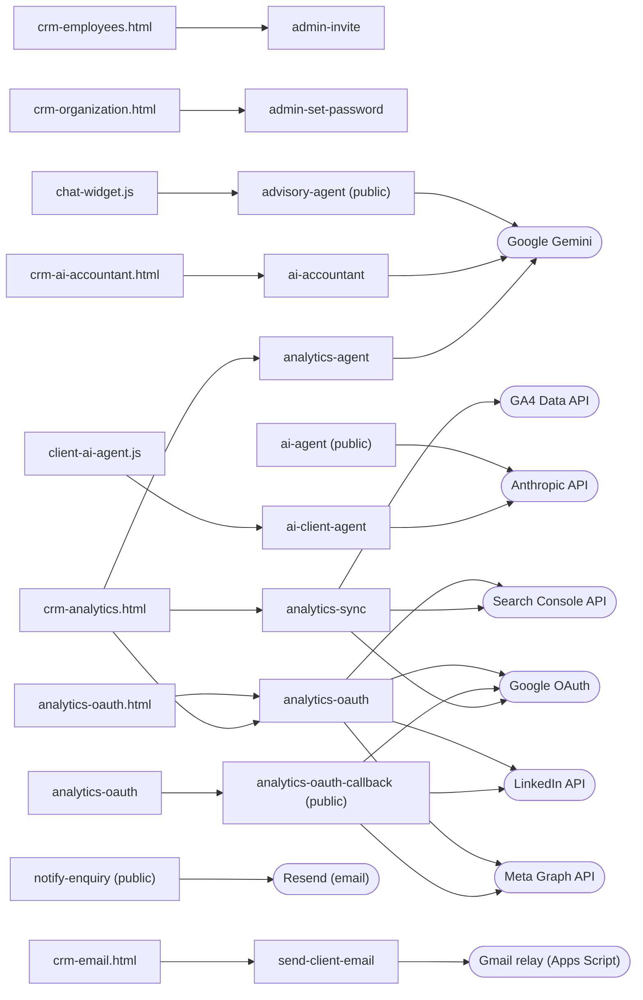

# Codebase map

Generated by `npm run graph` on 2026-11-12 from the source (no database access).
Machine-readable graph: [`codebase-graph.json`](codebase-graph.json).

| Kind | Count |
|---|---|
| table | 111 |
| view | 44 |
| external | 11 |
| function | 12 |
| script | 19 |
| library | 4 |
| page | 65 |
| rpc | 49 |
| edges | 1067 |

## Layers

## Edge functions

## Pages

| Page | Group | Shared scripts | Tables/views | RPCs | Functions |
|---|---|---|---|---|---|
| 404.html | public | – | 0 | 0 | – |
| about.html | public | animations.js | 0 | 0 | – |
| admin.html | portal | supabase-client.js | 15 | 0 | – |
| advisory.html | public | animations.js | 0 | 0 | – |
| analytics-oauth.html | portal | supabase-client.js | 0 | 0 | analytics-oauth |
| architecture-interiors-construction.html | public | animations.js | 0 | 0 | – |
| assessment-tools.html | public | animations.js | 0 | 0 | – |
| careers.html | public | animations.js | 0 | 0 | – |
| case-studies.html | public | supabase-client.js, animations.js | 1 | 0 | – |
| certificate-view.html | document | supabase-client.js | 1 | 0 | – |
| client-portal.html | portal | – | 0 | 0 | – |
| construction-interiors.html | public | – | 0 | 0 | – |
| contact.html | public | supabase-client.js, animations.js | 2 | 0 | – |
| crm-ai-accountant.html | crm | supabase-client.js, crm-auth.js, crm-activity.js | 10 | 4 | ai-accountant |
| crm-ai-control-center.html | crm | supabase-client.js, crm-auth.js, crm-activity.js, crm-nav.js | 7 | 3 | – |
| crm-alerts.html | crm | supabase-client.js, crm-auth.js, crm-activity.js | 2 | 2 | – |
| crm-analytics.html | crm | supabase-client.js, crm-auth.js, crm-activity.js | 2 | 6 | analytics-agent, analytics-oauth, analytics-sync |
| crm-business-rules.html | crm | supabase-client.js, crm-auth.js, crm-activity.js | 3 | 1 | – |
| crm-command-center.html | crm | supabase-client.js, crm-auth.js, crm-activity.js | 11 | 3 | – |
| crm-conversations.html | crm | supabase-client.js, crm-auth.js, crm-activity.js | 3 | 2 | – |
| crm-daily-entry.html | crm | supabase-client.js, crm-auth.js, crm-activity.js | 3 | 5 | – |
| crm-email.html | crm | supabase-client.js | 3 | 0 | send-client-email |
| crm-employee-costs.html | crm | supabase-client.js, crm-auth.js, crm-activity.js | 6 | 2 | – |
| crm-employees.html | crm | supabase-client.js, crm-auth.js, crm-activity.js | 2 | 4 | admin-invite |
| crm-finance-reports.html | crm | supabase-client.js, crm-auth.js, crm-activity.js | 6 | 1 | – |
| crm-finance.html | crm | supabase-client.js, crm-auth.js, crm-activity.js, crm-forms.js, crm-extras.js, crm-links.js | 13 | 3 | – |
| crm-financial-settings.html | crm | supabase-client.js, crm-auth.js, crm-activity.js | 6 | 3 | – |
| crm-form-builder.html | crm | supabase-client.js, crm-auth.js, crm-activity.js | 1 | 2 | – |
| crm-opportunities.html | crm | supabase-client.js, crm-auth.js, crm-activity.js, crm-forms.js, crm-extras.js, crm-links.js | 7 | 3 | – |
| crm-orders.html | crm | supabase-client.js, crm-auth.js, crm-activity.js, crm-forms.js, crm-extras.js, crm-links.js | 13 | 2 | – |
| crm-organization.html | crm | supabase-client.js, crm-auth.js, crm-activity.js | 6 | 2 | admin-set-password |
| crm-outsourced-offers.html | crm | supabase-client.js, crm-auth.js, crm-activity.js | 6 | 3 | – |
| crm-pharma-master.html | crm | supabase-client.js, crm-auth.js, crm-activity.js | 6 | 2 | – |
| crm-project-costing.html | crm | supabase-client.js, crm-auth.js, crm-activity.js | 11 | 2 | – |
| crm-quotations.html | crm | supabase-client.js, crm-auth.js, crm-activity.js, crm-forms.js, crm-extras.js, crm-links.js, crm-intl.js | 13 | 3 | – |
| crm-reports.html | crm | supabase-client.js, crm-auth.js, crm-activity.js | 12 | 0 | – |
| crm-rm-dashboard.html | crm | supabase-client.js, crm-auth.js, crm-activity.js | 4 | 3 | – |
| crm-stockists.html | crm | – | 2 | 1 | – |
| crm-website-capture-snippet.html | snippet | supabase-client.js, crm-intl.js | 2 | 0 | – |
| crm.html | crm | supabase-client.js, crm-auth.js, crm-activity.js, crm-forms.js, crm-extras.js, crm-links.js, crm-intl.js | 9 | 3 | – |
| custom-clearance-consultancy.html | public | animations.js | 0 | 0 | – |
| factory-performance.html | public | – | 0 | 0 | – |
| flagship-audit-insert-pack.html | snippet | – | 0 | 0 | – |
| global-trade-sourcing-snippets.html | snippet | supabase-client.js | 2 | 0 | – |
| global-trade-sourcing.html | public | animations.js | 0 | 0 | – |
| index.html | public | animations.js | 0 | 0 | – |
| insight-hidden-factory.html | public | – | 0 | 0 | – |
| insight-integration-snippet.html | snippet | – | 0 | 0 | – |
| insights.html | public | supabase-client.js, animations.js | 2 | 0 | – |
| invoice-view.html | document | supabase-client.js | 3 | 1 | – |
| jabran-method-upgrade.html | snippet | – | 0 | 0 | – |
| my-account.html | portal | supabase-client.js, crm-auth.js, crm-activity.js | 11 | 0 | – |
| plant-audit-deepdive-upgrade.html | snippet | – | 0 | 0 | – |
| podcast.html | public | animations.js | 0 | 0 | – |
| ppap-revert-previous.html | snippet | animations.js | 0 | 0 | – |
| privacy.html | public | animations.js | 0 | 0 | – |
| production-plant-audit-performance.html | public | animations.js | 0 | 0 | – |
| quotation-view.html | document | supabase-client.js, crm-auth.js, crm-activity.js | 5 | 3 | – |
| receipt-view.html | document | supabase-client.js | 5 | 1 | – |
| report-view.html | document | supabase-client.js | 1 | 0 | – |
| reset-password.html | portal | supabase-client.js | 0 | 0 | – |
| seo-jsonld-snippet.html | snippet | – | 0 | 0 | – |
| terms.html | public | animations.js | 0 | 0 | – |
| trading.html | public | – | 0 | 0 | – |
| training-academy.html | public | animations.js | 0 | 0 | – |

## Most-used tables and views

| Object | Used by (files) |
|---|---|
| crm_organizations | 13 |
| crm_settings | 11 |
| crm_enquiries | 9 |
| crm_orders | 7 |
| crm_services | 7 |
| crm_audit_logs | 6 |
| ai_conversations | 5 |
| ai_usage_log | 4 |
| crm_attachments | 4 |
| crm_cost_centres | 4 |
| crm_projects | 4 |
| crm_my_organization | 4 |
| crm_order_ebitda | 4 |
| ai_agent_configs | 3 |
| ai_agent_handoffs | 3 |
| ai_messages | 3 |
| ai_prompt_versions | 3 |
| analytics_connections | 3 |
| analytics_oauth_tokens | 3 |
| crm_employee_profiles | 3 |
| crm_field_config | 3 |
| crm_invoices | 3 |
| crm_quotations | 3 |
| crm_receipts | 3 |
| crm_employee_cost_rates | 3 |

## Referenced in code but not found in production

- `product_lines` (table) ← global-trade-sourcing-snippets.html
- `trade_inquiries` (table) ← global-trade-sourcing-snippets.html

## Production objects no file references directly

Used only inside the database (triggers, RPCs, views) or not used yet.

**Tables (72):** ai_conversation_summaries, analytics_accounts, analytics_alerts, analytics_attribution, analytics_campaigns, analytics_conversion_events, analytics_fact_map, analytics_generated_reports, analytics_metric_definitions, analytics_role_permissions, case_study_approvals, crm_activity_events, crm_agent_accounts, crm_ai_agents, crm_cost_lines, crm_counters, crm_outsourced_categories, crm_quotation_approvals, crm_tracking_template_steps, pharma_adverse_events, pharma_campaigns, pharma_companies, pharma_company_contacts, pharma_complaints, pharma_distributor_products, pharma_distributor_territories, pharma_doctor_affiliations, pharma_doctor_products, pharma_doctors, pharma_engagement_spend, pharma_expense_dimensions, pharma_field_force, pharma_hospitals, pharma_inventory_batches, pharma_inventory_movements, pharma_invoices, pharma_offer_categories, pharma_offer_products, pharma_offer_targets, pharma_pharmacies, pharma_plant_capabilities, pharma_product_prices, pharma_product_regulatory, pharma_production_batches, pharma_products, pharma_promotional_offers, pharma_recalls, pharma_receipts, pharma_returns, pharma_role_permissions, pharma_sales_order_items, pharma_sales_orders, pharma_sample_items, pharma_sample_transactions, pharma_tender_products, pharma_tenders, pharma_territories, pharma_toll_contracts, pharma_toll_enquiries, pharma_toll_offers, pharma_visit_plans, pharma_visits, pharma_warehouses, social_assets, social_audit_log, social_brand_voice, social_channels, social_content_calendar, social_engagement, social_posts, social_settings, training_quiz_attempts

**Views (34):** analytics_fact_enquiries, analytics_fact_opportunities, analytics_fact_orders, analytics_fact_quotations, analytics_my_orgs, crm_allocations_monthly, crm_cost_line_performance, crm_cost_sheet_breakdown, crm_cost_sheet_items_classified, crm_expense_ledger_monthly, crm_fx_realised, crm_labour_monthly, crm_my_timesheets, crm_order_direct_labour, crm_overhead_lines, crm_receivables_payment_breakdown, crm_service_offers_selectable, crm_upcoming_renewals, pharma_allocated_costs, pharma_campaign_performance, pharma_campaign_roi, pharma_credit_exposure, pharma_distributor_pl, pharma_doctor_spend_status, pharma_field_activity, pharma_order_totals, pharma_product_pl, pharma_receivables_ageing, pharma_revenue_lines, pharma_sample_balances, pharma_stock_positions, pharma_territory_pl, pharma_toll_comparison, pharma_unallocated_expenses
